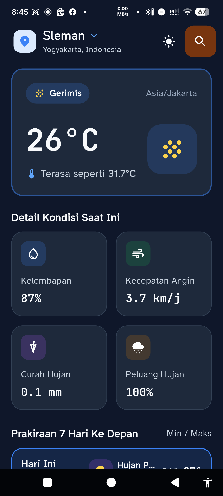
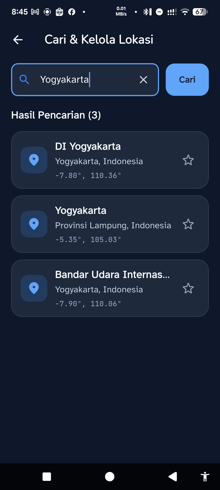

# Cuaca
### Nama: Dzikru Yunus Khabibi
### NIM: H1D024136
### Shift KRS: D
### Shift Prak: G

Aplikasi informasi cuaca berbasis **Flutter** dengan arsitektur **MVVM (Model–View–ViewModel)** yang terintegrasi dengan **Open-Meteo API** (tanpa memerlukan API key). Dirancang dengan fokus pada keterbacaan tinggi, aksesibilitas, dukungan mode terang/gelap (*Light & Dark Mode*), serta penyimpanan lokasi favorit secara lokal.

---

## Daftar Isi

- [Fitur Utama](#fitur-utama)
- [Tangkapan Layar](#tangkapan-layar)
- [Arsitektur Proyek](#arsitektur-proyek)
- [Struktur Direktori](#struktur-direktori)
- [Integrasi API](#integrasi-api)
- [Teknologi & Dependensi](#teknologi--dependensi)
- [Cara Menjalankan Proyek](#cara-menjalankan-proyek)
- [Pengujian & Analisis Kode](#pengujian--analisis-kode)

---

## Fitur Utama

- **Informasi Cuaca Terkini (`CurrentWeatherCard`)**
  - Menampilkan suhu saat ini dalam `°C`, suhu terasa (*apparent temperature*), label kondisi cuaca berbahasa Indonesia berdasarkan kode cuaca WMO, ikon cuaca, dan zona waktu lokasi.
- **Detail Kondisi Cuaca (`WeatherMetricGrid`)**
  - Grid metrik responsif (2 kolom pada layar sempit `< 640px` dan 4 kolom pada layar lebar `>= 640px`) yang menampilkan:
    - **Kelembapan** (`%`)
    - **Kecepatan Angin** (`km/j`)
    - **Curah Hujan** (`mm`)
    - **Peluang Hujan Hari Ini** (`%`)
- **Prakiraan Cuaca Harian (`DailyForecastItem`)**
  - Menampilkan daftar prakiraan cuaca harian (7 hari ke depan dari Open-Meteo) lengkap dengan penanda **Hari Ini**, nama hari & tanggal berformat Indonesia, ikon dan deskripsi kondisi cuaca, peluang hujan (`%`), serta suhu minimum dan maksimum harian.
- **Pencarian Kota Global (`SearchScreen`)**
  - Pencarian lokasi real-time menggunakan Open-Meteo Geocoding API dengan mekanisme *debounce* `500ms` saat mengetik maupun pencarian langsung melalui tombol **Cari**.
- **Lokasi Favorit & Persistensi Lokal (`LocalStorageService`)**
  - Simpan dan hapus lokasi favorit menggunakan ikon bintang (dilengkapi pencegahan duplikasi berdasarkan nama kota dan toleransi koordinat).
  - Menyimpan lokasi terakhir yang dipilih di `SharedPreferences` sehingga tetap termuat saat aplikasi dibuka kembali (lokasi default awal: **Purwokerto, Jawa Tengah, Indonesia**).
- **Tema Terang & Gelap (*Light & Dark Mode*)**
  - Pergantian tema instan langsung dari tombol pada AppBar dengan palet warna `SkylearnColors` dan tipografi Google Fonts (`Nunito`, `Atkinson Hyperlegible`, dan `JetBrains Mono` untuk angka metrik).
- **Penanganan State UI & Pembaruan Data**
  - Mendukung state `loading`, `success`, `empty`, dan `error` (termasuk penanganan gangguan koneksi, *timeout* 15 detik, dan kesalahan parsing data) melalui `StateFeedbackView`, serta fitur tarik untuk menyegarkan (*pull-to-refresh*).
- **Aksesibilitas & Responsivitas**
  - Target sentuh minimum `56x56` untuk tombol aksi utama, font hiperlegibel, dan batas lebar konten maksimal `840px` agar tampilan tetap proporsional di perangkat ponsel maupun layar lebar.

---

## Tangkapan Layar

| Beranda (Dark Mode) | Lokasi Favorit Tersimpan | Hasil Pencarian Lokasi |
| :---: | :---: | :---: |
| .png) | .png) | .png) |

---

## Arsitektur Proyek

Aplikasi ini menerapkan pola arsitektur **MVVM** dengan `Provider` sebagai *state management*:

1. **Models (`lib/models/`)**: Merepresentasikan struktur data lokasi (`LocationModel`) dan cuaca (`WeatherModel`, `CurrentWeather`, `DailyForecast`) serta proses serialisasi/deserialisasi JSON.
2. **Services (`lib/services/`)**: Menangani komunikasi HTTP ke Open-Meteo API (`WeatherApiService`) dan penyimpanan lokal berbasis `SharedPreferences` (`LocalStorageService`).
3. **ViewModels (`lib/viewmodels/`)**: Turunan `ChangeNotifier` (`WeatherViewModel` dan `LocationViewModel`) yang mengelola logika bisnis, state UI (`WeatherUiState` dan `SearchUiState`), *debounce* pencarian, dan konfigurasi tema.
4. **Views & Widgets (`lib/views/`, `lib/widgets/`)**: Lapisan antarmuka yang hanya berfokus pada rendering UI dan mendengarkan perubahan state dari ViewModel melalui `Consumer` / `context.select`.
5. **Core (`lib/core/`)**: Berisi konstanta endpoint & key penyimpanan (`ApiConstants`), sistem desain & tema (`AppTheme`, `SkylearnColors`), serta helper pemetaan kode cuaca WMO (`WeatherHelper`).

---

## Struktur Direktori

```text
cuaca/
├── assets/
│   └── screenshot/
│       ├── screen(1).png
│       ├── screen(2).png
│       └── screen(3).png
├── lib/
│   ├── core/
│   │   ├── api_constants.dart        # Endpoint Open-Meteo, parameter API, key SharedPreferences, lokasi default
│   │   ├── app_theme.dart            # Palet SkylearnColors, lightTheme, darkTheme, dan gaya font metrik
│   │   └── weather_helper.dart       # Pemetaan kode cuaca WMO ke label Indonesia, ikon, dan warna
│   ├── models/
│   │   ├── location_model.dart       # Model lokasi kota, koordinat, dan helper tampilan
│   │   └── weather_model.dart        # Model cuaca terkini (CurrentWeather) & harian (DailyForecast)
│   ├── services/
│   │   ├── local_storage_service.dart# Penyimpanan favorit & lokasi terakhir via SharedPreferences
│   │   └── weather_api_service.dart  # HTTP client Open-Meteo Geocoding & Forecast API + WeatherApiException
│   ├── viewmodels/
│   │   ├── location_viewmodel.dart   # State pencarian kota (debounce 500ms) & manajemen lokasi favorit
│   │   └── weather_viewmodel.dart    # State cuaca, pemilihan lokasi aktif, retry, dan toggle tema
│   ├── views/
│   │   ├── home_screen.dart          # Halaman utama cuaca terkini, detail metrik, dan prakiraan harian
│   │   └── search_screen.dart        # Halaman pencarian kota dan daftar lokasi favorit
│   ├── widgets/
│   │   ├── current_weather_card.dart # Kartu ringkasan kondisi dan suhu saat ini
│   │   ├── daily_forecast_item.dart  # Item daftar prakiraan cuaca harian
│   │   ├── location_tile.dart        # Item lokasi dengan indikator aktif & tombol bintang favorit
│   │   ├── state_feedback_view.dart  # Tampilan reusable untuk state loading, empty, dan error
│   │   └── weather_metric_grid.dart  # Grid responsif metrik kelembapan, angin, curah & peluang hujan
│   └── main.dart                     # Entry point aplikasi dan konfigurasi MultiProvider
├── test/
│   └── widget_test.dart              # Widget test awal untuk memastikan kota default tampil
├── analysis_options.yaml             # Konfigurasi linter (package:flutter_lints)
└── pubspec.yaml                      # Metadata proyek dan daftar dependensi
```

---

## Integrasi API

Aplikasi ini menggunakan layanan gratis dari **Open-Meteo** (membutuhkan koneksi internet dan izin `android.permission.INTERNET` pada Android):

1. **Open-Meteo Geocoding API**
   - Endpoint: `https://geocoding-api.open-meteo.com/v1/search`
   - Parameter: `name`, `count=10`, `language=id`, `format=json`
2. **Open-Meteo Weather Forecast API**
   - Endpoint: `https://api.open-meteo.com/v1/forecast`
   - Parameter `current`: `temperature_2m,relative_humidity_2m,apparent_temperature,precipitation,weather_code,wind_speed_10m`
   - Parameter `daily`: `weather_code,temperature_2m_max,temperature_2m_min,precipitation_probability_max`
   - Parameter `timezone`: `auto`

---

## Teknologi & Dependensi

Proyek ini menggunakan **Dart SDK `^3.5.0`** dengan paket utama berikut:

| Paket | Versi | Kegunaan |
| :--- | :--- | :--- |
| `provider` | `^6.1.2` | State management & dependency injection untuk ViewModel |
| `http` | `^1.2.2` | Permintaan HTTP GET ke Open-Meteo API |
| `shared_preferences` | `^2.3.2` | Penyimpanan lokal daftar lokasi favorit & lokasi terakhir |
| `google_fonts` | `^6.2.1` | Tipografi (`Nunito`, `Atkinson Hyperlegible`, `JetBrains Mono`) |
| `intl` | `^0.19.0` | Pemformatan tanggal prakiraan cuaca |
| `cupertino_icons` | `^1.0.8` | Set ikon tambahan |
| `flutter_lints` | `^4.0.0` | Aturan analisis statis kode Dart/Flutter (*dev dependency*) |

---

## Cara Menjalankan Proyek

### Prasyarat
- **Flutter SDK** terpasang dengan dukungan **Dart SDK `^3.5.0`**
- Emulator Android/iOS, perangkat fisik, atau target desktop/web yang aktif
- Koneksi internet untuk mengambil data cuaca dari Open-Meteo API

### Langkah Instalasi

1. **Masuk ke direktori proyek:**
   ```bash
   cd cuaca
   ```
2. **Unduh seluruh dependensi:**
   ```bash
   flutter pub get
   ```
3. **Jalankan aplikasi:**
   ```bash
   flutter run
   ```

---

## Pengujian & Analisis Kode

Untuk memeriksa kualitas kode menggunakan analyzer dan menjalankan widget test yang tersedia:

```bash
flutter analyze
flutter test
```
### Screenshot:

 <br> <br>
 <br>
 <br>